  <picture>
    <source media="(max-width: 600px)" srcset="assets/profile-banner.svg" />
    
  </picture>

  

  <a href="https://daironstiven12.github.io/Portafolio/">Portafolio</a> ·
  <a href="https://www.linkedin.com/in/daironorejuela/">LinkedIn</a> ·
  <a href="https://github.com/daironstiven12">GitHub</a>

  

## Perfil

  
  Soy estudiante de Ingeniería de Telecomunicaciones e Informática en la Universidad Tecnológica del Chocó (UTCH) y Tecnólogo en Desarrollo de Software del SENA. Me interesa crear soluciones digitales útiles y sigo fortaleciendo mis habilidades con proyectos prácticos.

### Tecnologías

  

Actualmente estoy aprendiendo Node.js y bases de datos para ampliar mis conocimientos de desarrollo full-stack.

  

## Proyectos

<table width="100%">
  <tr>
    <td width="33%" valign="top">
      
      
<a href="https://github.com/daironstiven12/React">Ver repositorio</a>

    </td>
    <td width="33%" valign="top">
      
      
<a href="https://github.com/daironstiven12/1-Angular">Ver repositorio</a>

    </td>
    <td width="33%" valign="top">
      
      
<a href="https://github.com/daironstiven12/Vue">Ver repositorio</a>

    </td>
  </tr>
</table>

  

## Actividad en GitHub

  <picture>
    <source media="(prefers-color-scheme: dark)" srcset="https://github-readme-stats.vercel.app/api?username=daironstiven12&amp;show_icons=true&amp;hide_border=true&amp;locale=es&amp;bg_color=0D1117&amp;title_color=0A9BFF&amp;text_color=D1D5DB&amp;icon_color=0A9BFF" />
    
  </picture>
  <picture>
    <source media="(prefers-color-scheme: dark)" srcset="https://github-readme-stats.vercel.app/api/top-langs/?username=daironstiven12&amp;layout=compact&amp;langs_count=6&amp;hide_border=true&amp;locale=es&amp;bg_color=0D1117&amp;title_color=0A9BFF&amp;text_color=D1D5DB" />
    
  </picture>

  <picture>
    <source media="(prefers-color-scheme: dark)" srcset="https://raw.githubusercontent.com/daironstiven12/daironstiven12/output/github-snake-dark.svg" />
    
  </picture>

  

## Contacto

  <a href="https://daironstiven12.github.io/Portafolio/">Portafolio</a> ·
  <a href="https://www.linkedin.com/in/daironorejuela/">LinkedIn</a> ·
  <a href="https://github.com/daironstiven12">GitHub</a>

