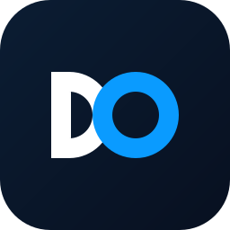

  

  

  Estudiante de Telecomunicaciones e Informática en la UTCH, enfocado en desarrollo web e interfaces de usuario.

  <a href="https://daironstiven12.github.io/Portafolio/">Portafolio</a> |
  <a href="https://www.linkedin.com/in/daironorejuela/">LinkedIn</a> |
  <a href="https://github.com/daironstiven12">GitHub</a>

---

## Sobre mí

Soy estudiante de Ingeniería de Telecomunicaciones e Informática en la Universidad Tecnológica del Chocó (UTCH) y Tecnólogo en Desarrollo de Software del SENA. Me interesa crear soluciones digitales útiles y sigo fortaleciendo mis habilidades con proyectos prácticos.

- Desarrollo web con React, Angular y Vue
- Diseño de interfaces y experiencia de usuario
- Inteligencia artificial y automatización

## Tecnologías

<table width="100%">
  <tr>
    <td width="24%"><b>Fundamentos</b></td>
    <td>
      
      
      
      
      
    </td>
  </tr>
  <tr>
    <td><b>Frameworks explorados</b></td>
    <td>
      
      
      
      
      
    </td>
  </tr>
  <tr>
    <td><b>Herramientas</b></td>
    <td>
      
    </td>
  </tr>
  <tr>
    <td><b>En aprendizaje</b></td>
    <td>Node.js y bases de datos, para completar el desarrollo full-stack.</td>
  </tr>
</table>

## Proyectos

Un proyecto de práctica con cada framework.

<table width="100%">
  <tr>
    <td width="33%" valign="top">
       
      <b><a href="https://github.com/daironstiven12/React">Enrutamiento con React</a></b> 
      React 19, React Router 7, Vite  
      Práctica de enrutamiento entre páginas con React Router, creada con Vite y React-Bootstrap.  
      <a href="https://github.com/daironstiven12/React">Ver repositorio</a>
    </td>
    <td width="33%" valign="top">
       
      <b><a href="https://github.com/daironstiven12/1-Angular">DsMovie</a></b> 
      Angular 21, TypeScript, RxJS  
      Aplicación estilo Netflix que consume la API pública de TVMaze, con búsqueda de series, detalle y favoritos guardados en el navegador.  
      <a href="https://github.com/daironstiven12/1-Angular">Ver repositorio</a>
    </td>
    <td width="33%" valign="top">
       
      <b><a href="https://github.com/daironstiven12/Vue">DevCode Academy</a></b> 
      Vue 3, Vite, JavaScript  
      Landing page para una academia de programación, con nueve secciones, diseño adaptable a móvil y formulario con validación.  
      <a href="https://github.com/daironstiven12/Vue">Ver repositorio</a>
    </td>
  </tr>
</table>

## Actividad en GitHub

  <picture>
    <source media="(prefers-color-scheme: dark)" srcset="https://github-readme-stats.vercel.app/api?username=daironstiven12&amp;show_icons=true&amp;hide_border=true&amp;locale=es&amp;bg_color=0D1117&amp;title_color=0A9BFF&amp;text_color=D1D5DB&amp;icon_color=0A9BFF" />
    
  </picture>
  <picture>
    <source media="(prefers-color-scheme: dark)" srcset="https://github-readme-stats.vercel.app/api/top-langs/?username=daironstiven12&amp;layout=compact&amp;langs_count=6&amp;hide_border=true&amp;locale=es&amp;bg_color=0D1117&amp;title_color=0A9BFF&amp;text_color=D1D5DB" />
    
  </picture>

## Contacto

  
  
  

